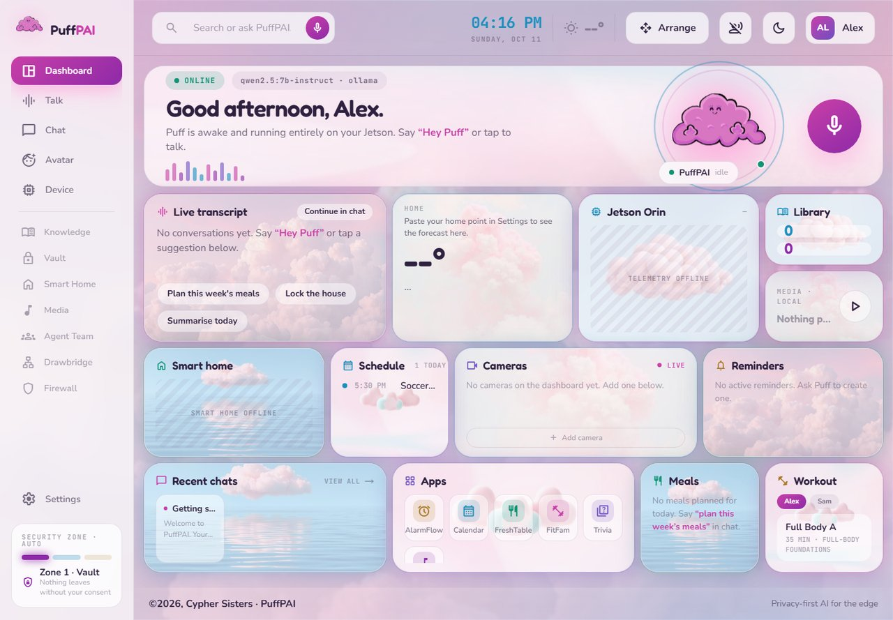
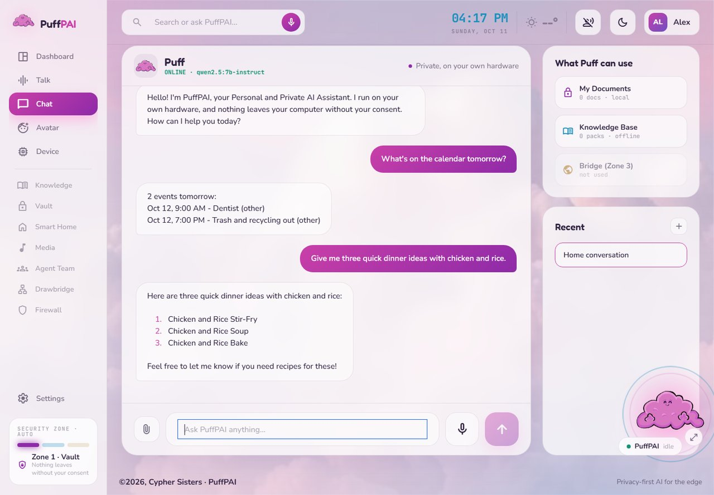
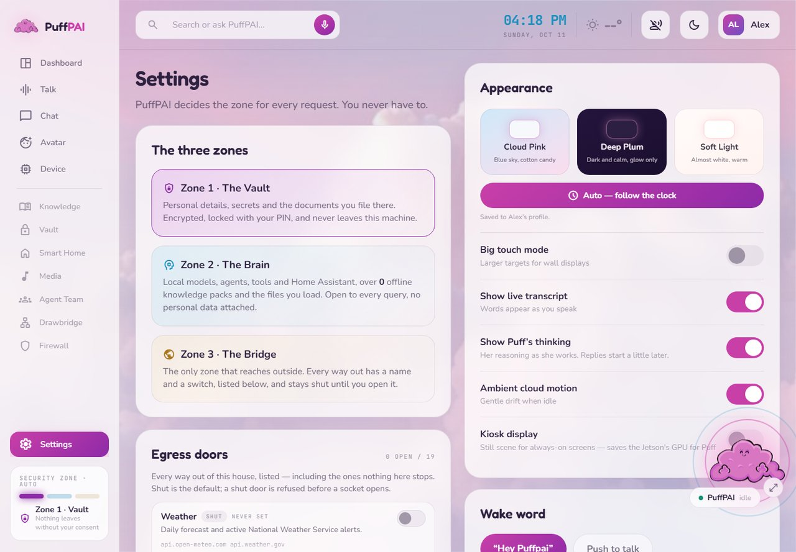
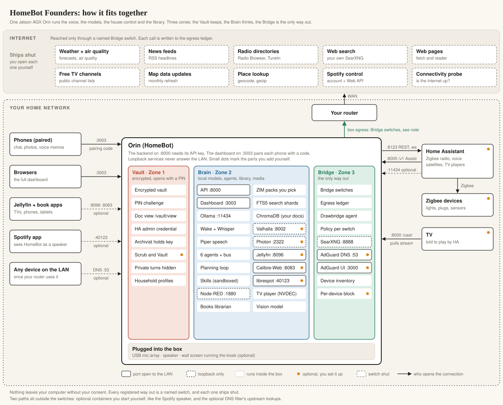

# HomeBot Founders Edition: a private, offline-capable home AI for the NVIDIA Jetson AGX Orin

**Your Hardware. Your Data. Your AI.**

HomeBot Founders Edition is a self-hosted, local AI assistant for your home that
runs on an NVIDIA Jetson AGX Orin you own: a local LLM through Ollama, a voice
assistant with its own wake word, Home Assistant control, and an offline
knowledge library read from Kiwix ZIM files. There is no cloud account and no
subscription. Every registered outbound connection has a name and a switch,
and the Bridge ships closed; the few that are not registered yet are listed
under Known gaps in [`AGENTS.md`](AGENTS.md). It is part of [PuffPAI](https://www.puffpai.com) by Cypher Sisters.

**You need:** a Jetson AGX Orin 64 GB with an NVMe, a USB mic array and a
speaker for voice, and Home Assistant for smart-home control. Not on an Orin?
See [Which repository](#which-repository).

## First use: emergency preparedness

A cloud assistant stops when the internet does. HomeBot works with the internet
off: the models, the voice and the knowledge search run on the Orin. How much it
can do offline depends on the build. (It still needs power; a UPS is optional
and not integrated, see [`docs/HARDWARE.md`](docs/HARDWARE.md).)

**An offline library you choose.** [`docs/KNOWLEDGE_PACKS.md`](docs/KNOWLEDGE_PACKS.md)
lists 66 Kiwix packs in ten groups, each with its official download, size and
license: medical reference (WikEM emergency medicine, MDWiki, field and military
medicine manuals), preparedness and self-reliance (Ready.gov in English and
Spanish, water purification, knots, food storage, post-disaster guides, the
Survivor Library), repair, home and food (iFixit, home improvement, car repair,
cooking), encyclopedias and reference (Wikipedia from a 6.5 GB best-of to the
118.7 GB edition with images, Wiktionary), travel and maps (Wikivoyage), books,
science, technology and more. No pack ships with the repository and this build
never downloads one on its own: you download the ones you want from Kiwix,
then build the search index on the Orin.

```bash
# copy the downloaded .zim file into /data/puffpai/knowledge/zim (paths.zim_dirs), then:
cd /opt/puffpai && sudo -u puffpai env PYTHONPATH=src PUFFPAI_DATA_DIR=/data/puffpai/state \
  venv/bin/python -m puffpai.knowledge.fts_build_cli
```

The build is resumable: if it stops, run it again. The pack then appears in
the knowledge library list (`GET /knowledge/libraries`). Medical packs are
reference material, not medical advice.

**Offline maps and directions.** Founders includes offline maps and
directions; you build the map data for your region. "Directions to the hospital", "nearest
pharmacy", "nearest gas station", by car, on foot or by bike, answered by two
engines on the Orin (Valhalla for routes, Photon for places, both on loopback).
The steps go to the screen with a print page and a QR code that opens the route
in Organic Maps on a phone. Nothing map-related ships prebuilt, and the
installer does not set it up: the runbook uses Texas as the worked example,
about 6.2 GB of downloads on another computer, copied to the Orin, then a build
of roughly 1 to 2.5 hours (an estimate). Another region means changing four
things, listed in the runbook. You also set
a home point in Settings. A monthly map refresh runs only through the "Map data
updates" Bridge switch, which ships shut. The phone link has not yet been
tested with a real phone scan. Step by step:
[`deploy/maps/RUNBOOK.md`](deploy/maps/RUNBOOK.md); the API:
[`docs/MAPS_ROUTE_API.md`](docs/MAPS_ROUTE_API.md).

But it's built to be anything you want.

<p>



</p>

Home, Chat and Settings, taken on a test machine with a small local model and nothing else connected. The calendar answer comes straight from the calendar; the dinner ideas come from the model, on the machine.

## How it fits together

<picture>
  <source media="(max-width: 700px)" srcset="docs/images/architecture-phone.svg">
  
</picture>

One Jetson AGX Orin runs the voice, the models, the house control and the library. Solid boxes are ports open to your home network, dashed boxes listen on the box only, and the orange dots are the parts you add yourself. More detail, with the request flows: [`docs/ARCHITECTURE.md`](docs/ARCHITECTURE.md).

<details>
<summary><b>Everything it can do, in one list</b></summary>

Everything below is in this repository. Rows marked **(optional)** are pieces you set up or switch on yourself. Every registered way out to the internet is a named Bridge switch, and each one ships shut. Two paths are not registered, and the Spotify and DNS filter rows say which. Nothing leaves your computer without your consent.

| Capability | How it works |
|---|---|
| Voice | Say "hey puffpai". Whisper turns speech into text on the Orin, the brain answers, and Piper speaks up to two sentences while the full answer goes on screen. Say "stop" to cut it off. |
| Chat | The dashboard on `:3003` talks to the same local models, from the wall screen, a browser or a phone. |
| One conversation | Voice, chat and phone turns land in one household thread, so you can start by voice and finish in chat. |
| Send to Puff | A phone page on your home Wi-Fi: send photos and documents, type to it, or leave a voice memo. A phone joins with a code from the dashboard. |
| The agent team | Seven agents. Concierge talks to you and holds no keys. Steward runs the house and media. Archivist keeps memory, the library and the vault. Majordomo runs reminders and scheduled work. Caretaker checks the services. Toolsmith reaches the web through the Bridge. Drawbridge reviews every change and can veto it. |
| Planning and workflows | Multi-step asks run as a short plan of tool steps; saved workflows run on request. |
| Skills | New abilities install only with your consent, run in a sandbox, and go out only through a Bridge switch. |
| The Vault | Private documents and secrets live encrypted. A PIN opens a short-lived viewer for one document, and turns that carry vault contents are never saved to chat history or shown on the wall. Scrub and Vault, which moves personal details out of chat memory into the vault, is **optional** and ships off. |
| Home Assistant control **(optional)** | Lights, plugs, climate and scenes. Drawbridge reviews each change, then the Steward, the only agent with the Home Assistant token, calls Home Assistant. Safety-critical devices need your confirmation. |
| Provisioning and Zigbee pairing **(optional)** | New automations and pairing a Zigbee device ask for your consent, then use a Home Assistant admin credential kept in the vault. |
| Home blueprint **(optional)** | A floorplan of your house with devices on it, and a layer showing which ones talk out. |
| Offline library | Download the Kiwix packs you want (66 are listed with sizes and licenses); the Orin builds a full-text index and answers from them with the internet off. |
| Your documents | Files you upload are indexed on the box, and "search my documents for X" answers from them. |
| Books **(optional)** | A librarian over your Calibre library, also served to readers by Calibre-Web on `:8083`. |
| Radio | Radio by genre on the house speaker. TuneIn and Radio Browser are Bridge switches. |
| Jellyfin **(optional)** | Search and playback from your own Jellyfin on `:8096`, a container you start yourself. |
| TV **(optional)** | Free channel lists behind their own switch, played full screen on the wall screen by the Orin's hardware decoder, or cast to a TV through Home Assistant. |
| Apps | Alarms, calendar, FitFam, FreshTable meals and trivia. |
| Emergency prep | A supplies inventory, alongside the offline library and maps for when the internet is down. |
| Maps **(optional)** | Offline directions and "nearest X" from Valhalla and Photon on loopback, with a print page and a QR code for Organic Maps. You build the map data for your region; monthly updates go through a switch. |
| Web search | Your own SearXNG on loopback, installed with the rest, closed until you open its switch. |
| Spotify **(optional)** | Containers that make the Orin a Spotify speaker, plus voice control through the Spotify switch. While a container runs it connects on its own; stopping it is its switch. |
| Automations | Node-RED on loopback, installed with the rest; it runs the flows you import. |
| House DNS filter **(optional)** | AdGuard Home in Zone 3, inert until you point your router at it and turn protection on. Its upstream DNS lookups are not behind a switch. |
| Device inventory | A list of the devices on your network. Per-device blocking is **optional** and runs only after you grant it. |
| Wall screen **(optional)** | The dashboard full screen on a display plugged into the Orin. |

</details>

## How this was built

We're two people, and we vibe coded the whole thing with AI coding tools
(Claude Code). It works, and we think it's awesome. The code is probably a hot
mess in places, and we'd love real coders and engineers to take a crack at it.

Where help is most welcome:

* **The failing tests.** The [Test status](#install) paragraph names the groups
  they fall into. Fixing a group, or showing a test is wrong, is a great first
  pull request.
* **The known gaps** in [`AGENTS.md`](AGENTS.md) section 1: dashboard routes
  that ask their switch but are not pinned or written to the egress ledger,
  containers that connect on their own while they run, and app data that is
  protected by file permissions only.
* **A first install on a fresh Orin.** The installer has not been run end to
  end on one yet (see Install).
* **Maps for your region**, and the phone scan test of the Organic Maps link.
* **Reading the code and telling us what you'd change**: refactors,
  architecture, tests. Use the
  [code feedback](https://github.com/CypherSisters/HomeBotFounders/issues/new?template=code_feedback.md)
  issue, or [open any issue](https://github.com/CypherSisters/HomeBotFounders/issues/new/choose).

How to file an issue, send a pull request and run the tests:
[`CONTRIBUTING.md`](CONTRIBUTING.md). The system's promises and the contracts
that pin them: [`AGENTS.md`](AGENTS.md).

## What's in the box

**The three zones.** Every PuffPAI ships all three.

| Zone | Name | What it is here |
|---|---|---|
| 1 | **The Vault** | Encrypted store for PII, secrets and personal context. PIN-gated; the AI has to ask. A turn that carries vault contents is never saved to chat history or shown on the wall panel. `src/puffpai/security/vault.py`, `scrub_and_vault.py`, `vault_view.py` |
| 2 | **The Brain** | Local models, the agents, tool calls, Home Assistant, the knowledge index. `src/puffpai/agents/`, `inference/`, `knowledge/` |
| 3 | **The Bridge** | The only zone that reaches outside. Named egress switches (`security/egress_doors.py`), an AdGuard Home DNS sinkhole that ships inert (`zone3/`), and an nftables per-device block backend that runs only if you set `PUFFPAI_FIREWALL_BACKEND=nftables` and grant it `CAP_NET_ADMIN` (`firewall_manager.py`). No packet filter ships and nothing here is switched on by default; without the opt-in, the block buttons refuse and say so. |

**The agent team.** Seven master agents. Six live in the Brain (Concierge,
Steward, Archivist, Majordomo, Caretaker, Toolsmith) and one lives in the
Bridge: **Drawbridge**, the security agent, which gates what the others may do
(`src/puffpai/agents/registry.py`, `agents/preferences.py`). They route to each
other and plan multi-step work. State-changing actions pass Drawbridge's
review; Home Assistant provisioning asks for your consent, and safety-critical
devices need a human confirmation. The general consent gate ships off
(`PUFFPAI_ENFORCE_CONSENT=0`, see [`docs/CONFIG.md`](docs/CONFIG.md)).

| Surface | What it does | Where |
|---|---|---|
| Dashboard | Next.js UI on `:3003`: chat, household, knowledge, Skills, media, Books, settings. Themes per profile (Cloud Pink, Deep Plum, Soft Light). Live transcript of the spoken turn, reasoning in a side panel, and a Tap to stop bar while it speaks | `dashboard/` |
| Voice | On-box wake word, Whisper, the brain, Piper. Music dips for an addressed exchange, not for mere listening. "Stop" cuts a reply mid-sentence, and `POST /voice/stop` does the same from the dashboard. Follow-ups that sound like a request are answered without the wake word; room talk is not (delete `puffpai-voice.service.d/30-followup.conf` to turn it off). Optional: a two-pass check that the wake name was really said (`PUFF_WAKE_CONFIRM=1`; the shipped unit sets `0`). Spoken PINs and vault replies are kept out of the voice journal | `src/puffpai/voice/`, `voice/log_privacy.py`, `systemd/user/puffpai-voice.service` |
| Home Assistant | Entity control, Zigbee pairing assistant, HA provisioning under consent. The home blueprint: a floorplan of your house with devices on it and a traffic layer showing which ones talk out, read from the Zone 3 ledger | `src/puffpai/ha_bridge.py`, `zigbee_pairing.py`, `ha_provisioning.py`, `home_layout.py`, `home_traffic.py` |
| Zone 3 | AdGuard Home DNS sinkhole, ships inert; egress ledger and a policy per switch | `docker-compose.zone3.yml`, `src/puffpai/security/egress_ledger.py` |
| Device Sentinel | LAN inventory: a small OUI table, plus an optional scikit-learn stage that is NOT installed by default (`pip install .[ml]`) and returns UNKNOWN without it | `src/puffpai/device_sentinel.py`, `security/device_classifier.py`, `security/device_ml.py` |
| Knowledge | ZIM packs and uploaded documents, indexed with local embeddings and an FTS index. Big ZIM libraries browse like a website straight from the FTS shard; whole books are indexed in parts. "Search my documents for X" is answered from the upload index with no model round, and only documents that mention X count | `src/puffpai/knowledge/`, `knowledge/shard_browse.py`, `agents/document_reads.py` |
| Maps | Offline directions and "nearest X" from Valhalla and Photon on loopback, with a print page and a phone QR code; set up by hand (see above) | `src/puffpai/maps_directions.py`, `deploy/maps/` |
| Books | A librarian over your Calibre library: categories, shelves (the same ones Calibre-Web shows), "what do I have on X". It names only books you really have | `src/puffpai/books/` |
| Media | Jellyfin search and playback, and a Jellyfin playlist built from a list you sent. Radio discovery with genre ranking and one favorites list for the household. TuneIn is its own Bridge switch, closed until you open it | `media_bridge.py`, `media_hub.py`, `radio_player.py` |
| Apps | Alarms, calendar (with a week view), FitFam, FreshTable meals, trivia. "Delete the dentist" removes only what matches: it asks which one when two do, and checks the calendar after the write. A bare hour ("before nine") takes the half of the day still ahead, or asks when both could be meant | `apps/`, `src/puffpai/calendar_nl.py`, `calendar_dates.py` |
| Skills | Sandboxed, consent-installed extensions, each one reaching out only through the Bridge. A lost internet connection is reported as that, not as a broken skill | `src/puffpai/skills/` |
| Automations | Node-RED flows behind fixed `/webhook/*` paths | `nodered_flows/`, `docker-compose.nodered.yml` |
| Web search | Self-hosted SearXNG on loopback, off until you open its switch | `searxng/` |

## Hardware

What it is built for, and what it costs you to deviate. Full table with
notes: [`docs/HARDWARE.md`](docs/HARDWARE.md).

| Component | Required | Tested with |
|---|---|---|
| Jetson AGX Orin, 64 GB | yes | AGX Orin 64 GB dev kit |
| NVMe, 80 GB free minimum | yes | 1 TB NVMe mounted at `/data` |
| USB mic array | for voice | ReSpeaker XVF3800 |
| Speaker (any PulseAudio sink) | for voice | USB / 3.5 mm |
| Home Assistant + Zigbee coordinator | for smart home | HAOS on a separate host |
| Display, UPS | no | n/a |

Four models, about 39 GB on disk, are pulled at install: `gpt-oss:20b`,
`qwen3:30b-a3b`, `qwen2.5vl:7b`, `nomic-embed-text`
(`scripts/install_ubuntu.sh`). 64 GB of RAM is what it is built for; below 32 GB
the chat and planner models will not fit side by side. Knowledge packs and maps
need their own disk on top: from 9 MB to over 200 GB per pack.

## Install

**What has been run, and what has not.** The installer has not yet been run
end to end on a fresh Orin; it prints `NOTE: this step has not been verified on
a fresh box` on the phases that are unproven (among them the dashboard, SearXNG
and voice). If one fails, open a
[bug report](https://github.com/CypherSisters/HomeBotFounders/issues/new?template=bug_report.md)
with the log.

**Before you start, by hand.** Flash JetPack 6.2.2 (Ubuntu 22.04), then
partition, format and mount the NVMe at `/data`. The installer never touches
partitions and refuses to run with less than 80 GB free there. Details:
[`docs/INSTALL_ORIN.md`](docs/INSTALL_ORIN.md) section 1.

**1. Get the code** onto the Orin (seconds):

```bash
git clone https://github.com/CypherSisters/HomeBotFounders.git && cd HomeBotFounders
```

**2. See what it will do** (seconds). Every command is printed and none runs:

```bash
sudo bash scripts/install_orin.sh --dry-run
```

**3. Install** (45 to 120 minutes, nearly all of it the model download). It
installs the code, the four models, the dashboard and the services, then checks
them:

```bash
sudo bash scripts/install_orin.sh
```

It ends with `HomeBot is installed.` and the dashboard address. If a check
failed it lists each one under `VERIFY FAILURE(S)` and exits non-zero. On a
fresh box expect that list to name the Home Assistant and Jellyfin values
(`HA_TOKEN`, `HA_BASE_URL`, `HA_ACCESS_TOKEN`, `JELLYFIN_API_KEY`) that are
still `CHANGE_ME`: they are yours to paste in, and the installer prints which
file holds each. Anything else in that list is a real problem.

**4. Open the dashboard** at the address it printed (`http://<orin-address>:3003`)
and pair your first device with the code it shows. Then tighten the pairing
gate with the two commands the installer printed under `PAIRING`.

**5. Check it before you rely on it:** a few questions you know the answers
to, a voice round trip, a vault unlock, Home Assistant control, and the same
with the internet unplugged.

Flags (`--yes`, `--with-zone3`, `--with-kiosk`, `--skip-models`,
`--skip-voice`) and every step the script takes:
[`docs/INSTALL_ORIN.md`](docs/INSTALL_ORIN.md). On a development machine or
x86_64, `scripts/install_ubuntu.sh` installs the backend alone, and
[`AGENTS.md`](AGENTS.md) section 3 runs it by hand.

**Test status.** The full suite at this release, split across 8 processes on a
Windows development PC rather than the Orin: 14,968 passed, **62 failed**, 130
skipped. The largest group is the planning loop (33 tests written for older
routing), then chat tool binding (6), and a handful that expect a live model,
Orin-specific paths, or Linux-only tools, or that depend on the order tests run
in. No CI runs on this repository yet.

## First run

| Thing | Where |
|---|---|
| Dashboard | `http://<orin-address>:3003` |
| Backend | `:8000`, API-key gated (`PUFFPAI_API_KEY`). On the Orin it binds `0.0.0.0` so an off-box Home Assistant can reach it; set `PUFFPAI_API_BIND=127.0.0.1` in `/etc/puffpai/api.env` if nothing off the box needs it |
| Pairing | First device on the LAN pairs with a code from the dashboard; `PUFF_PAIRING_ENFORCE` decides how strict the gate is (`dashboard/app/_lib/server/pairing.ts`) |
| Wall display | Same URL with `?puffMode=kiosk`, which engages the motion governor so a static page does not pin the GPU (`docs/KIOSK_MODE.md`) |
| Writable state | `/data/puffpai/state` (`PUFFPAI_DATA_DIR`), models and index under `/data/puffpai` |
| Secrets | `/etc/puffpai/api.env` and `dashboard.env`, `0640 root:puffpai`, written by the installer and never overwritten once filled |
| Config | `config/puffpai_config.json`. Every `paths.*` entry must be absolute before the service runs under systemd |
| Logs | `journalctl -u puffpai-api -f` |

Every setting and environment variable the runtime reads:
[`docs/CONFIG.md`](docs/CONFIG.md).

## Privacy

Every registered outbound connection has a name and a switch, and the Bridge
ships closed. Each switch
has a fixed host list and a stated purpose, and one forced shut in the unit
file cannot be reopened from the UI. The full list is generated from the code:
[`docs/WHAT_CAN_LEAVE_YOUR_HOUSE.md`](docs/WHAT_CAN_LEAVE_YOUR_HOUSE.md)
(regenerate with `python scripts/gen_egress_doc.py`). What the switches do not
cover yet is listed under "Known gaps" in [`AGENTS.md`](AGENTS.md).

Zone 3 ships inert twice over: nothing points at the resolver until you change
the router, and protection is off in the seeded configuration
(`docker-compose.zone3.yml`).

## Which repository

| Repository | Pick it when |
|---|---|
| **HomeBot Founders Edition** (this one) | You have a Jetson AGX Orin 64 GB and want the complete build, installed and tuned for that board |
| [`CypherSisters/HomeBotBuild`](https://github.com/CypherSisters/HomeBotBuild) | You want HomeBot on a Windows or Linux PC you already own (64-bit Windows 10/11 or Linux); its setup wizard sizes the model to your machine |
| [`CypherSisters/PuffPAIBuildBot`](https://github.com/CypherSisters/PuffPAIBuildBot) | You want to make your own private bot for something other than the home, on your own computer. BuildBot is the bot-building tool HomeBot's setup wizard comes from |

More about PuffPAI: [puffpai.com](https://www.puffpai.com).

## License

Apache-2.0. See [`LICENSE`](LICENSE), [`THIRD_PARTY_NOTICES.md`](THIRD_PARTY_NOTICES.md),
[`CONTRIBUTING.md`](CONTRIBUTING.md) and [`SECURITY.md`](SECURITY.md).
Security reports: GitHub private vulnerability reporting (see [`SECURITY.md`](SECURITY.md)).
