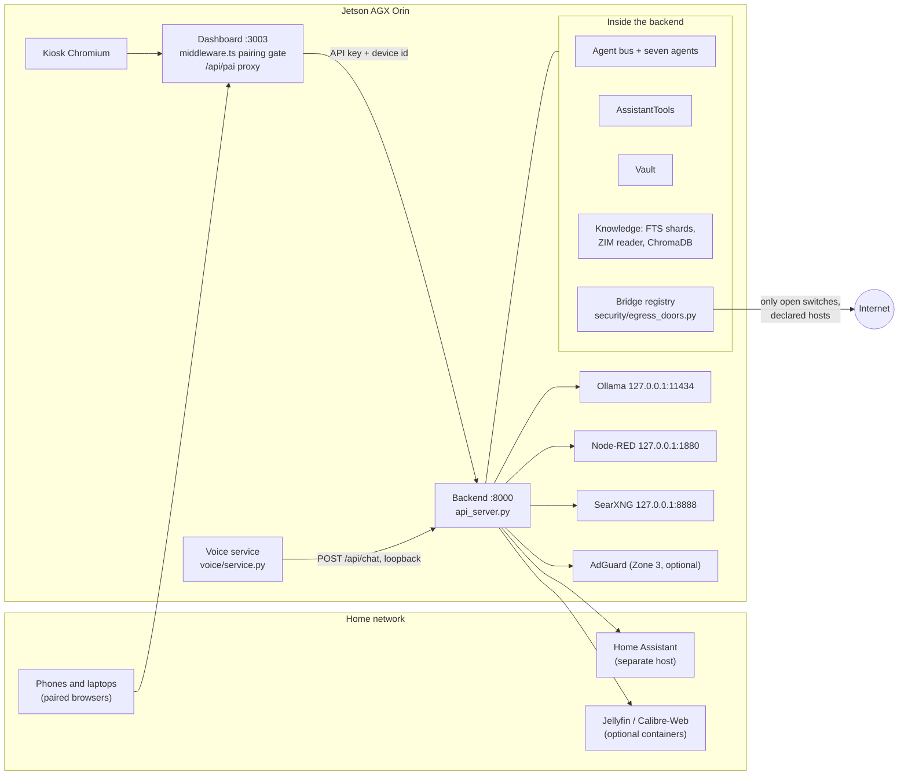
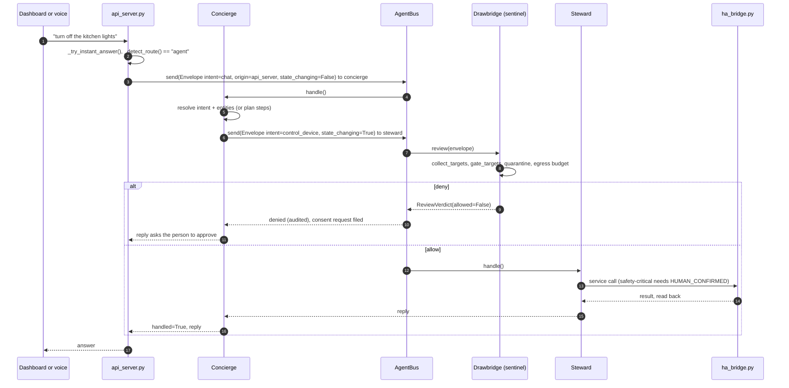
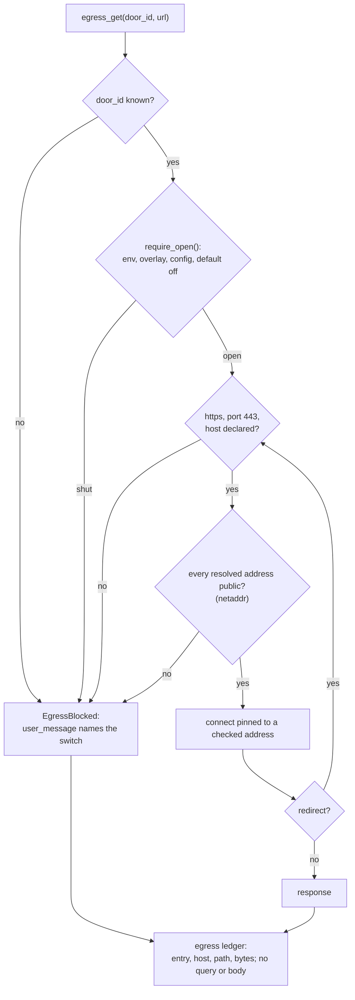

# Reference architecture: HomeBot Founders Edition

This document describes how the Founders Edition build is put together: the
processes it runs, the three zones and where each lives in code, how a request
moves through the agents, and where every trust boundary sits. File paths are
relative to the repository root; `api_server.py` means `src/puffpai/api_server.py`
unless another directory is given. The working guide for changing the code is
[`AGENTS.md`](../AGENTS.md); the product overview is [`README.md`](../README.md).

Every PuffPAI has three zones. **The Vault**: your personal data, encrypted,
caught automatically and kept out of the AI's memory, and even the AI needs your
permission to look. **The Brain**: local models, agents, tools and knowledge.
**The Bridge**: the only way to the outside. Every way out has a name and a switch,
and the Bridge ships closed. The promises you can check yourself are in
[`SECURITY.md`](../SECURITY.md); this document is about the implementation.

## 1. Processes and units

| Process | How it runs | Listens on | Defined in |
|---|---|---|---|
| Backend (Flask, threaded) | native, `puffpai-api.service`, user `puffpai`, `ProtectSystem=strict` | `0.0.0.0:8000` by default; `PUFFPAI_API_BIND=127.0.0.1` restricts it | `systemd/puffpai-api.service`, `start_api.py` `main()` |
| Dashboard (Next.js 16, `next start`) | native, `puffpai-dashboard.service`, user `puffpai` | `:3003` | `systemd/puffpai-dashboard.service`, `dashboard/package.json` |
| Dashboard loopback media proxies | inside the dashboard process, only when `JELLYFIN_LAN_HOST` / `CALIBRE_LAN_HOST` are set | `127.0.0.1:8096`, `127.0.0.1:8083` | `dashboard/instrumentation.ts` |
| Voice service | native, systemd **user** unit `puffpai-voice.service` | no port; posts to the backend | `systemd/user/puffpai-voice.service` and its drop-ins, `src/puffpai/voice/service.py` |
| Ollama | native, the upstream installer's unit plus a drop-in | `127.0.0.1:11434` only | `systemd/ollama.service.d/override.conf` |
| Node-RED | Docker, started by `puffpai-nodered.service` (a root oneshot around `docker compose`) | `127.0.0.1:1880` | `docker-compose.nodered.yml`, `systemd/puffpai-nodered.service` |
| SearXNG | Docker, started by the installer | `127.0.0.1:8888` | `searxng/docker-compose.searxng.yml` |
| AdGuard Home (Zone 3 resolver) | Docker, `puffpai-zone3.service`, only with `install_orin.sh --with-zone3` | LAN `:53`, LAN and loopback `:3000` | `docker-compose.zone3.yml`, `systemd/puffpai-zone3.service` |
| Jellyfin, Calibre-Web | Docker, optional, started by hand | LAN `:8096`, `:8083` on `PUFFPAI_BIND_IP` | `docker-compose.media.yml` |
| librespot (Spotify Connect) | Docker, optional, host network | host | `docker-compose.spotify.yml`, `docker-compose.spotify-voice.yml` |
| Radio player (mpv) | Docker, one named container `puffpai-radio` the backend starts per stream with `docker run` | none | `radio_player.py` |
| Kiosk | GDM xsession: openbox plus Chromium in kiosk mode at `http://127.0.0.1:3003/dashboard` | none | `kiosk/kiosk-session.sh`, `kiosk/puffpai-kiosk.desktop`, [`KIOSK_MODE.md`](KIOSK_MODE.md) |

Notes that matter when you change any of this:

- `start_api.py` hardcodes port 8000; `api_server.host` / `api_server.port` in the
  config are not read on that path. Every route except `/health` and a few
  justified exemptions needs the API key (section 7).
- The service account is deliberately not in the `docker` group, because that group
  is root-equivalent. The Node-RED and Zone 3 units run `docker compose` as root
  oneshots for that reason. The server-side radio player calls `docker run` from
  the backend, so it works only where the operator has given the service account
  Docker access; the browser player in the dashboard does not need it.
- Inside the backend, `start_background_services()` (`api_server.py`) starts daemon
  threads: the model warm-up, the Device Sentinel (off unless
  `PUFFPAI_SENTINEL_ENABLED=1`), the agent team, the Home Assistant event listener
  (`ha_events.py`, read-only websocket), the alarm and reminder scheduler
  (`scheduler.py`) and the Majordomo task dispatcher (`agents/dispatcher.py`).

## 2. The three zones in code

| Zone | What it guarantees here | Where it lives |
|---|---|---|
| **Vault** | Personal data encrypted at rest with AES-256-GCM under a random data key, wrapped under keys derived (scrypt) from the PIN and from the recovery code; the PIN check is PBKDF2-SHA256 at 480,000 iterations; PIN and recovery code have separate lockouts; every access is audited; sessions time out after 15 minutes, and an unlocked chat window lasts 5 minutes | `security/vault.py` (`Vault`), `security/vault_view.py` (single-use view tokens), `security/scrub_and_vault.py`, `security/ha_vault.py`, `security/audit_log.py`; routes `/vault/*` in `api_server.py` |
| **Brain** | Inference and orchestration on the device | `inference/` (`ollama_backend.py`, `model_options.py`), `agents/`, `assistant_tools.py`, `agent_graph.py`, `capability_registry.py`, `router.py`, `knowledge/`, `ha_bridge.py`, `apps/`, `skills/` |
| **Bridge** | Nothing leaves without a named, switched, ledgered path | `security/egress_doors.py` (registry and wrapper), `security/netaddr.py` (address checks, pinning), `security/lan_http.py` (house-only calls), `security/egress_admin.py` (the only writer), `security/egress_policy.py`, `security/egress_ledger.py`, `zone3/`, `bridge_inventory.py`, `bridge_ledger.py`, `firewall_manager.py` |

`security/zones.py` holds a `DataZone` enum and a static file-to-zone table used for
classification and status; it is not the enforcement point for any of the above.
The README and `zones.py` number the Vault as Zone 1; the names are what the code
keys on.

## 3. The seven agents and the bus

The roster is `ROSTER` in `agents/registry.py`; `build_team()` builds an
`AgentBus`, registers every agent and designates `sentinel` as the reviewer. The
team is on unless `PUFFPAI_AGENT_TEAM_ENABLED=0`.

| Agent (display name) | Id | Holds | Does |
|---|---|---|---|
| Concierge | `concierge` | no secrets | Fronts every request; deterministic intent resolution, then delegates or plans (`agents/concierge.py`) |
| Steward | `steward` | Home Assistant and media credentials | House and media actions; read tools plus actuators that must arrive `state_changing` (`agents/steward.py`) |
| Drawbridge | `sentinel` | AdGuard/firewall credentials, audit write | The veto on every state-changing envelope; device block and unblock (`agents/sentinel_agent.py`) |
| Archivist | `archivist` | vault and ChromaDB access | Memory and knowledge reads; the PII quality gate for Scrub-and-Vault (`agents/archivist.py`, `agents/pii_quality_gate.py`) |
| Majordomo | `majordomo` | automation and calendar | Scheduled and queued work, the daily briefing (`agents/majordomo.py`, `agents/dispatcher.py`) |
| Caretaker | `caretaker` | service control | Health probes and allowlisted service restarts (`agents/caretaker.py`) |
| Toolsmith | `toolsmith` | no secrets, by design | Web search and fetch under two consents, notes, a bubblewrap `workspace_exec` (`agents/toolsmith.py`) |

Display names come from `agents/preferences.py` `display_names()`. Scopes are
`AgentScope` in `security/secrets_provider.py`; `BaseAgent.secret()` resolves a
secret only under the agent's own scope, so a prompt-injected Concierge or Toolsmith
cannot read a house credential.

**The bus** (`agents/bus.py`). Agents never hold references to each other; they
call `self.ask(to, envelope)`, which is `AgentBus.send()`. For every envelope with
`state_changing=True`, `send()` asks the reviewer first; a missing reviewer, a
crashing review or an unrecognised verdict is a deny. Every send, veto, budget
abort and handler error is written to the audit log with payload keys only
(`Envelope.audit_view()`).

**The envelope** (`agents/envelope.py`) carries `requester` (the authenticated
principal, never a client value), `origin_agent`, `intent`, `payload`,
`state_changing` and a `Budget` (`max_actions`, `max_seconds`, `allow_egress`,
which defaults to `False`). Exceeding a budget raises `BudgetExceeded`, which the
bus turns into an audited abort.

**Drawbridge's review** (`SentinelAgent.review()`): targets are collected from the
payload by meaning (`collect_targets()`), passed to `consent_gate.gate_targets()`
(per-device consent, blast radius `PUFFPAI_MAX_BLAST_RADIUS`, safety-critical
domains), checked against Device Sentinel quarantine; an LLM-authored automation
goes through `consent_gate.sentinel_review()`; a payload asking for egress on a
budget without it is denied. On the bus a deny always blocks. Outside the bus, the
automation-authoring routes treat a `gate_targets` / `sentinel_review` deny as
binding only when `PUFFPAI_ENFORCE_CONSENT=1` and otherwise log it as a dry run.

**Consent requests** (`security/consent_requests.py`). When a target lacks consent,
Drawbridge files a request; the assistant asks the person in chat, and only the
tools `sentinel_approve_device` / `sentinel_deny_device` resolve it, and only for an
entity with an open request (`by="user_via_chat"`).

**Human confirmation** (`ha_bridge.py`). `SAFETY_CRITICAL_DOMAINS` (siren, lock,
alarm_control_panel, cover, valve, water_heater, camera) are enforced inside the
bridge's actuating methods, the last point before a service call leaves the box.
Only the in-process `HUMAN_CONFIRMED` object satisfies it; JSON cannot carry object
identity. Untargeted, broadcast and opaque-target calls are refused there too.

**The planning loop** (`agents/planning_loop.py`), on unless
`PUFFPAI_PLANNING_LOOP_ENABLED` is false: plan, act, observe, revise over a closed
`CATALOGUE`. It dispatches only through the Concierge's `_send_sub` to the bus,
sends state-changing steps one at a time, derives its budget as the minimum of its
limits and the parent's (`_derive_budget`), drops `DENIED_PAYLOAD_KEYS` such as
`confirmed` and `origin_agent`, treats a denial as terminal for that entity, and
seals the egress host set from the person's own request before the first step.

## 4. The chat path

The dashboard chat page (`dashboard/app/_lib/services/chatService.ts`) posts through
the paired proxy to `/chat/stream` (Server-Sent Events), falling back to
`/v1/chat/completions`, then posts the finished turn to `/chat/save`. `/chat/send`
is the non-streaming form.

Inside `chat_stream()` (`api_server.py`):

1. If a vault display challenge is pending, the message is treated as a PIN by
   `_try_vault_pin_followup()`; it never reaches a model and the turn is registered
   private.
2. `_prepare_user_message()` runs the PII scan. With `PUFFPAI_SCRUB_AND_VAULT` off
   (the default) the local model sees the raw text, history stores the redacted
   text, and detected items are vaulted. With it on, and a recovery code present,
   both see handles such as `{{vault:<ref>}} (your phone number)`.
3. `_detect_route()` picks `agent`, `rag`, `library` or `briefing`. Deterministic
   answers come first from `_try_instant_answer()`, a chain of `_try_*` helpers
   that need no model.
4. `agent` turns go to the team via `_try_team_chat()` (kill switch
   `PUFFPAI_CHAT_VIA_TEAM`); what the team does not claim goes to the tool agent
   (`AssistantTools` via `agent_graph.py`), which offers the model only the tools
   `capability_registry.tools_for_query()` binds.
5. The chat envelope's budget comes from `_chat_envelope_budget()`: egress only when
   the planning loop is on, the owner's `chat_allow_egress` policy is on, and a web
   switch is open (`egress_policy.chat_egress_allowed()`).
6. Vault answers go through `_maybe_vault_gated_answer()`, keyed by
   `_get_chat_client_id()` (section 7). A turn that carried vault content is
   registered with `_register_private_turn()`, the stream ends with
   `private: true`, and `/chat/save` refuses to persist it.

Chat history is written by `_save_conversation()` as JSON files under
`paths.chat_history_dir`, namespaced per principal when `PUFFPAI_MULTIUSER` is on.

## 5. The voice pipeline

`voice/service.py` is one process with no Flask, no model and no vault:

1. **Wake**: a raw-audio ONNX classifier (`PUFF_WAKE_MODEL`, default
   `/data/puffpai/models/hey_puffpai.onnx`) on `onnxruntime`, gated by RMS.
   An optional second pass transcribes the trigger and requires the name
   (`PUFF_WAKE_CONFIRM`; the shipped unit sets `0`).
2. **Capture and endpointing**: energy VAD with calibration.
3. **Speech to text**: faster-whisper by default (`PUFF_STT_ENGINE=whisper`), Vosk
   as the alternative. `parse_address()` decides whether the utterance was
   addressed to the assistant.
4. **Brain**: `ask_brain()` posts to `PUFF_BRAIN_URL`
   (`http://127.0.0.1:8000/api/chat`) with the header
   `X-Puff-Device-Id: voice-local-service`, so the spoken session has its own vault
   bucket. `/api/chat` is keyless for a loopback peer only
   (`endpoint_gate.LOCAL_ONLY_ENDPOINTS`) and runs `_process_voice_query()`, the
   same pipeline as chat, with spoken-reply limits (`PUFF_VOICE_MAX_SENTENCES`,
   `PUFF_VOICE_MAX_SPOKEN_WORDS`).
5. **Text to speech**: Piper (`PUFF_PIPER_MODEL`) played with `paplay` on the
   PulseAudio sink. "Stop" interrupts mid-sentence; `POST /voice/stop` writes
   `voice_control.json`, which the loop polls every 100 ms.
6. **Follow-ups**: after a reply the microphone stays open for
   `PUFF_FOLLOWUP_WINDOW` seconds (code default 10) when `PUFF_FOLLOWUP=1`; the
   shipped drop-in `30-followup.conf` turns it on. In the default `request` mode only
   a follow-up that sounds like a request is answered, up to
   `PUFF_FOLLOWUP_MAX_CHAIN` turns.
7. **Ducking** (`voice/ducking.py`, [`VOICE_DUCKING.md`](VOICE_DUCKING.md)): no dip
   for mere listening, a deep dip for an addressed exchange, a light "peek" dip for
   a likely missed wake while something plays.
8. **Journal privacy** (`voice/log_privacy.py`): utterances stay readable unless they
   are PIN-shaped or a vault challenge is armed; replies follow the backend's
   `private` flag and a content check. Every decision fails closed. Transcripts are
   written to disk only with `PUFF_LOG_TRANSCRIPTS=1`.

The dashboard shows the spoken turn live from `GET /voice/live`
(`_live_turn_snapshot()`), which withholds PIN-shaped text. Audio never leaves the
box; Home Assistant is not in the voice path.

## 6. The dashboard and its server-side proxy

- **Pages** live under `dashboard/app/dashboard/`. Browser code calls
  `NEXT_PUBLIC_API_URL` (`/api/pai`), never the backend directly.
- **Pairing** (`app/_lib/server/pairing.ts`, enforced in `middleware.ts` and again
  by `requirePairing()` in each proxy route). A device pairs with a one-hour code
  shown on the dashboard and receives the HMAC-signed `puff_device` cookie
  (one year, sliding 30-day renewal, revocable per device). `PUFF_PAIRING_ENFORCE`:
  `off`, `knowledge` (default: writes to the knowledge routes), or `all` (every
  proxy prefix); any other value means `all`. Paths are decoded and must be
  canonical before the decision (`effectiveGatePath()`). An upload-scoped device
  token (`deviceToken.ts`) is accepted for `POST /api/pai/knowledge/upload` only.
- **The keyed proxy** (`app/api/pai/[...path]/route.ts`) rejects encoded separators,
  checks the first path segment against `PROXY_ALLOWED_PREFIXES`
  (`proxyAllowlist.ts`; 404 otherwise, including the `automation` prefix used by
  `app/_lib/services/automationService.ts`), caps bodies at 50 MB, and builds
  upstream headers from scratch with `upstreamHeaders()` (`proxyHeaders.ts`):
  - `Authorization: Bearer <PUFFPAI_API_KEY>` from server-side config;
  - `X-Puff-Device-Id`: an HMAC-SHA256 of the device id under the pairing secret,
    truncated to 128 bits (`deviceSessionId()`), derived from the verified cookie;
    or, when there is no verified identity, `X-Puff-Anonymous: 1` instead;
  - the only relayed client header is `X-Vault-Token`, and only on paths whose first
    segment is `vault`;
  - `Content-Type` and `Accept`. Cookies, `X-Forwarded-*` and client copies of the
    identity headers never cross.
  Responses relay `content-type`, `cache-control`, `content-disposition`, plus the
  sandbox CSP headers on `/knowledge/library/<id>/asset`.
- **The identity contract in the backend** (`_get_chat_client_id()`): the device id
  header is honoured only when the socket peer is loopback or listed in
  `PUFFPAI_TRUSTED_PROXY_IPS` (no wildcard; a garbage value trusts nobody). The
  anonymous marker, a missing header or a malformed id from such a peer yields a
  fresh `anon:` key per request, which is refused vault answers. Any other peer is
  keyed by its socket address; `X-Client-Id` is ignored.
- **Other server routes**: `/api/ha/*` and `/api/camera/*` (keyed Home Assistant
  proxies), `/api/knowledge/source|asset` (keyless loopback fetches of the backend),
  `/api/pair/*`, `/api/health`, `/api/system/stats`, `/api/media/status`, and the
  outward routes listed in section 11.
- **Security headers** for `/dashboard/*` pages are set in `middleware.ts`
  (`X-Frame-Options: SAMEORIGIN`, CSP with `connect-src 'self'`).

## 7. Backend request gates

In registration order (`api_server.py`): `turn_scope.install(app)`,
`_begin_request_privacy`, `_rate_limit` (600 requests a minute per peer, separate
public and authenticated buckets), `_check_api_key`. The key check:

1. `_PUBLIC_ENDPOINTS` (`health`, `static`, the librespot event sink, the Spotify
   OAuth callback, the vault view and reveal routes, which check for a loopback peer
   and a single-use token themselves) pass. Each entry must have a reason in
   `endpoint_gate.PUBLIC_ENDPOINT_JUSTIFICATIONS`.
2. A matching key in `Authorization: Bearer` or `X-API-Key` passes, from anywhere.
3. `endpoint_gate.LOCAL_ONLY_ENDPOINTS` (the ingest routes, knowledge source and
   asset, the OpenAI- and Ollama-compatible chat and model lists,
   `voice_capabilities`) pass for a loopback peer or one named in
   `PUFFPAI_TRUSTED_LOCAL_PEERS`.
4. Everything else gets 401.

`X-Forwarded-For` is parsed only when `api_server.trusted_proxy_hops` is above 0
(`_apply_proxy_fix()`); when it is, the loopback exemptions are refused outright.
CORS answers only localhost origins. The key itself resolves vault, OS keyring,
environment, in that order (`_load_or_create_api_key()`), and the process refuses
to start without one.

## 8. Knowledge

- **ZIM reader** (`knowledge/zim_reader.py`): original code over the published ZIM
  format; LZMA and Zstandard clusters. No kiwix-serve and no libzim.
- **Full-text shards** (`knowledge/fts_index.py`): one SQLite FTS5 database per ZIM,
  built and resumed by `python -m puffpai.knowledge.fts_build_cli`; location from
  `resolve_fts_dir()` (`paths.fts_dir`, else a `fts` directory beside the first
  `paths.zim_dirs` entry). `knowledge/shard_browse.py` pages a library from its
  shard; without one it does a bounded walk.
- **Discovery** (`knowledge/discovery.py`) lists ZIM files from `paths.zim_dirs` and
  `paths.zim_files` for `GET /knowledge/libraries`.
- **ChromaDB RAG** (`knowledge/rag.py` `DualZoneRAG`): a vault collection that needs
  an authenticated session and a general collection, with provenance labels.
  Embeddings from `embeddings.py`.
- **Document upload** (`POST /knowledge/upload`, and `POST /ingest/upload` through
  `ingestion.ingest_file()`): text is extracted by `file_processor.py` (OCR and a
  local vision model for photos), then screened by `ingestion.screen_text_for_pii()`
  before chunking. High-tier PII
  (SSN, card, address, date of birth) sends the original into the Vault and indexes
  only redacted text; if the Vault is locked or the screen fails, nothing is
  indexed. The retained original is kept in plaintext only when the screen allows
  it. "Search my documents" is answered from the upload index
  (`upload_index.py`, `agents/document_reads.py`).
- **Books** (`books/`) reads the Calibre and Calibre-Web databases on disk.

## 9. Apps and app data

An app is a folder: `apps/<id>/app.json` (`puffpai_app/v1`), validated by
`app_registry.py` as data only: nothing is imported, evaluated or given to the model
as instructions; vocabulary only adds router keywords. Packs
(`packs/<id>/pack.json`, `puffpai_pack/v1`) bundle installed apps. Each manifest's
`doors` list becomes one Bridge entry per block, id `app:<id>:<n>`, shut by default
and digest-bound to its host list (`register_app_doors()`); the shipped apps
declare no hosts.

The five shipped apps (AlarmFlow, Calendar, FreshTable, FitFam, Trivia) keep their
state in `app_data/<id>.json` under the state root (`app_data.py` `AppData`),
written atomically at `0600` by `security/app_data_store.write_json_secure()`.
`security/app_data_tags.py` tags sensitive schema positions (medications, health
history) by class and tier for status reporting. App data is not encrypted.
Routes: `/apps/<name>/data` (GET, PUT), `/apps/<name>/action`, `/apps/rescan`.

## 10. Skills

`skills/` implements sandboxed, consent-installed capability packages:

- **Manifest** (`skills/manifest.py`, `puffpai_skill/v1`): refusal rules only;
  `skill.py` must fit the consent card (200 lines, 16 KB); triggers that any existing
  capability claims are refused.
- **Install** (`skills/install.py`): `propose_install()` files a consent request with
  a sha256 per file; `apply_approved_install()` writes only when the in-process
  `HUMAN_CONFIRMED` object is present, a fresh human-resolved approval exists on
  disk, and the files still hash to the card. Only then is the skill's switch
  written, bound to the digest of the approved host set.
- **Jail** (`skills/sandbox.py`): bubblewrap with the Toolsmith's flags, no network
  namespace, one writable path; the staged copy is re-hashed after each run. No
  bubblewrap means no run.
- **Broker** (`skills/broker.py`): the only way out; GET over https to declared
  hosts through `egress_request()`, with URL, query, request-count and response caps.
- **Dispatch** (`skills/dispatch.py`): the one caller; `PUFFPAI_SKILLS_DISABLED=1`
  stops everything; a skill answers last in the fastpath chain and only on a
  whole-utterance trigger match.
- **Store** (`skills/store.py`): `<state>/skills/`, never the code tree.

Worked example: `src/puffpai/skills_examples/iss_position/`.

## 11. The Bridge: egress

**The registry.** `DOORS` in `security/egress_doors.py` is the list of every
outbound destination the backend and the dashboard server may reach: `weather`,
`air_quality`, `news_rss`, `geocode`, `geoip`, `radio_browser`, `tunein`,
`web_search`, `web_fetch`, `page_reader`, `connectivity_probe`, `spotify`, plus app
and skill entries registered at runtime.
Each has hosts, purpose, what leaves, a config flag, a `PUFFPAI_EGRESS_*` variable
and `default=False`. The generated list is
[`WHAT_CAN_LEAVE_YOUR_HOUSE.md`](WHAT_CAN_LEAVE_YOUR_HOUSE.md)
(`python scripts/gen_egress_doc.py`, `--check` to verify).

**Enforcement tiers.** `registry`: the call goes through `egress_request()` and
cannot reach the network while shut. `external`: `web_search`, `web_fetch` and
`page_reader`, whose call sites (`assistant_tools.py` web search before `ddgs` is
imported, `agents/toolsmith.py` `_web_search`, `_web_fetch`, `_fetch_url`, and the
dashboard's `app/api/reader`) ask the switch first and add their own checks. `none`:
listed and not gated; no built-in entry is in this tier. `spotify` is a `registry`
entry: every call in `spotify_control.py` goes through `egress_request("spotify", ...)`.
`connectivity_probe` has no hosts of its own; `offline_guard.has_internet()`
probes only hosts behind switches that are already open.

**Node-RED.** The flows open their own connections, so the wrapper is not on that
path. Each function node that is about to call `api.weather.gov` or the feed in
`NEWS_RSS_URL` asks `GET /system/egress/door/<id>` (with `PUFFPAI_API_KEY`, to
`PUFFPAI_API_URL` only) and skips the call unless the answer is a clear yes; a
refused webhook run is answered through the tab's catch handler. On the backend,
`automation_client.WEBHOOK_SWITCHES` maps each such webhook to its switches, and
`AutomationClient.call`, `POST /automation/trigger` (403, `reason: bridge_closed`)
and the assistant's automation helper refuse to start it while any of them is off.

**Switches.** Resolution per entry is environment, then the owner overlay
`$PUFFPAI_DATA_DIR/state/egress_doors.json`, then `egress_doors` in
`config/puffpai_config.json`, then off; `GET /system/status` reports the source.
`POST /system/egress/door` (API key, reached through the paired dashboard) calls
`egress_admin.set_door_open()`, which refuses entries it cannot honestly toggle.
`GET /system/egress/door/<id>` (API key) answers whether one switch is open right
now, with its declared hosts, and nothing else.

**The dashboard server.** The Next.js routes that reach the internet ask that route
before any lookup or socket, through `app/_lib/server/bridgeSwitch.ts`, with the
same backend address and key as the `/api/pai` proxy. The dashboard keeps no copy
of any flag. `app/api/radio/search` and `app/api/radio/click/[uuid]` ask
`radio_browser` and contact only the mirrors that switch declares;
`app/api/tunein/search` and `app/api/tunein/resolve` ask `tunein` and contact only
`opml.radiotime.com` (a playlist TuneIn names on a broadcaster's server is skipped,
as the backend skips it); `app/api/reader` asks `page_reader`, a switch of its own
because a person opening a link is not the Toolsmith's `web_fetch` consent, and
then applies `urlGuard.ts`. Only a well-formed `open: true` for the asked id lets a
request through: a closed switch is a 403 `{reason: "bridge_closed", switch,
error}`, and a missing key, an unreachable backend or any other answer is a 503
`bridge_unavailable`. `error` is the sentence the radio panel and the reader
overlay show. A clear answer is reused for three seconds, a failure never.
`chat_allow_egress` is a policy, not a destination: it decides whether a chat turn
may use an open web switch at all (`egress_policy.py`, overlay
`$PUFFPAI_DATA_DIR/state/egress_policy.json`, `POST /system/egress/policy`).

**The guard on the source tree.** A test scans every `.py` file under `src/puffpai`
for outbound constructs (`requests`, `urllib`, `httpx`, `aiohttp`, websockets,
`create_connection`) and fails on any call site that is neither the registry nor a
listed loopback or LAN destination
(`test_no_outbound_call_site_outside_the_registry`); another fails on any hardcoded
public hostname no entry declares. `tests/test_egress_dashboard_switches.py` does the
same for the dashboard server: every route under `dashboard/app/api` that reaches
the internet must ask its switch before its first outbound call, and every public
hostname there must belong to a switch. House-local calls (Home Assistant, Jellyfin,
AdGuard, Node-RED, Zigbee2MQTT, Ollama) use loopback or `security/lan_http.py`, which
refuses any address that is not loopback, RFC 1918 or unique-local.

**Zone 3.** `docker-compose.zone3.yml` runs AdGuard Home, seeded with protection off
(`config/zone3/AdGuardHome.seed.yaml`); `zone3.enabled` ships `false` and nothing
points at the resolver until the router is changed ([`ZONE3_SETUP.md`](ZONE3_SETUP.md)).
`zone3/adguard_controller.py` drives it; `/bridge/*` (`bridge_routes.py`) is an
observe-only device inventory and traffic ledger. `firewall_manager.py`
`get_firewall_backend()` returns a backend that refuses to block on Linux unless
`PUFFPAI_FIREWALL_BACKEND=nftables` and the unit is granted `CAP_NET_ADMIN`.

**What is not there.** Stated plainly:

- No packet filter ships turned on, and no outbound firewall is installed. Every
  control above is in application code.
- The Bridge ships closed: no entry defaults open and the shipped config sets none.
- The dashboard server's gated routes are not the registry's wrapper: the radio and
  TuneIn routes do not pin the looked-up address, and none of their requests or
  refusals is written to the egress ledger. A playing radio stream connects to the
  station's host directly, from the browser or from the `puffpai-radio` container,
  with no switch.
- Node-RED flows are not loaded by default. Once imported, the weather and news
  flows ask their switch before each call, but that check lives in the flow: a copy
  without the check, or one edited in the Node-RED editor, can go out without
  asking, and `weather_alerts` runs on its own every two hours. The feed in
  `NEWS_RSS_URL` is not one of the hosts the `news_rss` entry lists, and Node-RED
  does not pin the looked-up address or write to the egress ledger.
- The librespot containers (`docker-compose.spotify.yml`,
  `docker-compose.spotify-voice.yml`) sign in to Spotify on their own while they run.
  The `spotify` switch does not reach them; stopping the container does.
- Home Assistant, Jellyfin and other services on the LAN make their own internet
  connections; those are theirs, and the Zone 3 resolver is the tool for seeing them.

## 12. Storage layout

On the appliance the writable root is `/data/puffpai`, and `PUFFPAI_DATA_DIR` is
`/data/puffpai/state`. Code lives read-only under `/opt/puffpai` and
`/opt/puffpai-dashboard`.

| What | Where | Resolved by |
|---|---|---|
| Runtime state (agent events, Majordomo queue, consent ledger and requests, Toolsmith workspace, skills, Bridge overlays, logs) | `$PUFFPAI_DATA_DIR/...` | `config.resolve_state_dir()`, `statedir.py` |
| Vault | `paths.vault_data_dir` via `resolve_state_dir` | `security/vault.py` `default_vault_dir()` |
| Chat history | `paths.chat_history_dir` | `api_server._get_chat_history_dir()` |
| App data | `app_data/` under the state root | `app_data.py` `_data_dir()` |
| Security audit trail | `paths.security_logs_dir` | `security/audit_log.py` |
| Egress ledger | `security_logs/egress.jsonl`, 4 MB x 3 rotations | `security/egress_ledger.py` |
| Models | `/data/puffpai/models` (Ollama under `models/ollama`) | `ollama.service.d/override.conf`, voice env |
| ZIM files and FTS shards | `/data/puffpai/knowledge/zim`, sibling `fts` | `paths.zim_dirs`, `resolve_fts_dir()` |
| ChromaDB | `paths.chromadb_path` | `config.py` |
| Pairing state and paired devices | `PUFF_PAIRING_STATE`, `PUFF_PAIRED_DEVICES` | `dashboard/app/_lib/server/pairing.ts` |

Config files: `config/puffpai_config.json` (every `paths.*` value must be absolute
before running under systemd), `config/home_assistant_config.json` (from the
`.example`), `/etc/puffpai/api.env` and `/etc/puffpai/dashboard.env` (`0640
root:puffpai`), `/etc/puffpai/kiosk.env`, `/opt/puffpai/.env` for the compose
stacks. Full reference: [`CONFIG.md`](CONFIG.md).

## 13. Security model and trust boundaries

| Boundary | Who is on each side | What holds it |
|---|---|---|
| LAN to dashboard | any device on the network / paired devices | pairing cookie, `middleware.ts`, `requirePairing()`, proxy allowlist |
| LAN to backend `:8000` | any device / holders of the API key | `_check_api_key`, loopback-only exemptions, rate limit. `PUFFPAI_API_BIND=127.0.0.1` removes LAN reach entirely |
| Dashboard proxy to backend | the proxy on loopback asserts device identity | `upstreamHeaders()`, `_get_chat_client_id()`, `PUFFPAI_TRUSTED_PROXY_IPS` |
| Household members | one principal's vault unlock versus another's | per-device session keys, 5-minute unlock window, `PUFFPAI_MULTIUSER` principals |
| Brain to house | model output to physical actions | bus veto, consent ledger, `SAFETY_CRITICAL_DOMAINS`, `HUMAN_CONFIRMED`, agent secret scopes |
| Brain to outside | box to internet | Bridge registry, address pinning, budgets, ledger |
| Untrusted content | web pages, app manifests, skills | Toolsmith holds no secrets and stamps output `untrusted`; manifests are data only; skills run jailed |
| Service account to host | `puffpai` to root | `ProtectSystem=strict`, `NoNewPrivileges`, not in `docker`, bubblewrap for execution |

Inside the "loopback with the API key" boundary there is no further authentication
of the caller: a local process can assert a device id. What it cannot do is guess
another member's 128-bit session id. See [`SECURITY.md`](../SECURITY.md) for the
reporting channel and the full statement.
